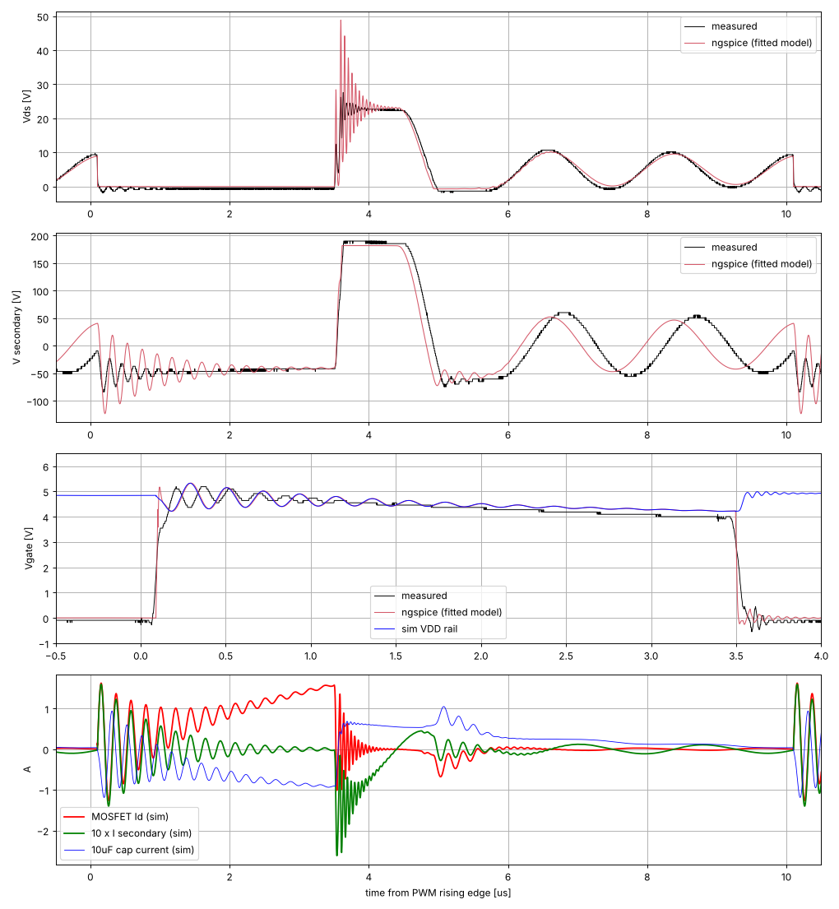
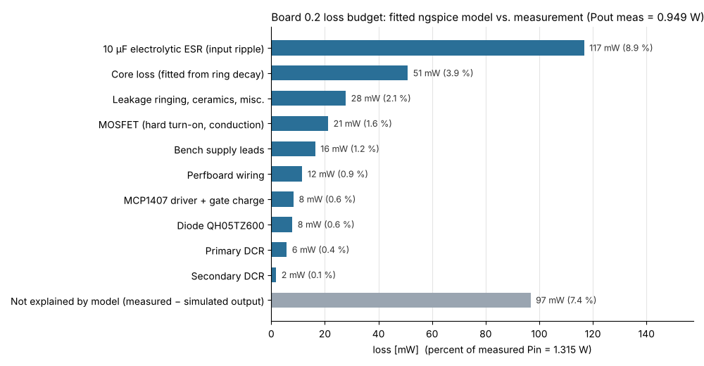
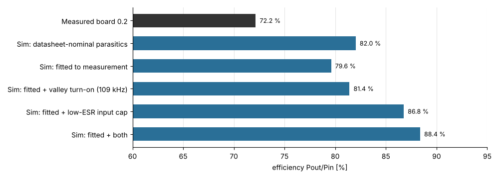

# Board 0.2 – waveform analysis and ngspice simulation

## 1. What the measurements say

| Quantity | Value |
|---|---|
| Input power | 4.8 V × 0.274 A = **1.315 W** |
| Output power | 172² / 31 160 Ω = **0.949 W** |
| Efficiency | **72.2 %** (0.366 W lost) |

From the scope captures (`pwm-*.csv`, plotted in `sim/img/measured.png`):

* **Operating point.** The converter runs at 100 kHz. PWM is high for 3.39 µs (D = 0.34), and the gate follows the PWM edge about 100 ns later.
* **Operating mode.** The converter runs in discontinuous mode (DCM). After turn-off the secondary conducts for about 1.2 µs. Then the drain rings freely for about 5 µs at **565 kHz**, with a decay time constant τ ≈ 16 µs.
* **Hard turn-on.** The MOSFET always turns on near a *peak* of that ring, at Vds ≈ 9–10 V (about 2·Vin). The node capacitance is discharged hard through the FET every cycle.
* **Ring capacitance.** The ring capacitance referred to the primary is about **8 nF** (565 kHz with 10 µH). With the probe moved to the secondary, the ring drops to 525 kHz. That is consistent with about 65 pF on the secondary side (winding self-capacitance, 76 pF interwinding capacitance, diode Cj) reflected ×100.
* **Turn-off spike.** The drain peaks at 27.6 V, well below the 60 V rating. The leakage ring is about 22 MHz and is strongly damped.
* **The 5 V rail sags on every pulse.** The gate voltage equals the MCP1407 supply. It falls from 4.8 V to 4.05 V during the on-time. The reflected primary voltage, read from the secondary on-state, falls from 48.7 V to 41.8 V on the secondary, i.e. 0.7 V on the primary. The 1.6 A peak primary current is drawn through a high-impedance supply path.
* **Scope caveat.** The secondary plateau reads 186–190 V although Vout is 172 V. The demagnetisation *time* does not depend on scope gain: 1.20 µs measured, 1.195 µs simulated at Vout = 172 V. That timing confirms 172 V. So the absolute CH3 reading at 100 V/div with a −204 V offset is off by roughly 7 % (offset and gain error). Do not use the absolute secondary voltage from these captures.

## 2. Simulation model (`sim/`)

| Part | Model used |
|---|---|
| CSD18533KCS | **TI vendor PSpice model** (SLPM047), downloaded and patched for ngspice by `get_models.sh` |
| DA2033-AL | Coupled inductors with Coilcraft datasheet values (doc 510): Lp 10 µH ±10 %, 1:10, leakage 0.144 µH, DCR 15 mΩ / 1.1 Ω. Coilcraft has no SPICE model for this part. |
| QH05TZ600 | Power Integrations does not publish SPICE models. Diode `.model` fitted to the datasheet: VF 2.6 V @ 5 A, CJ 17 pF @ 10 V, Qrr ≈ 6.5 nC |
| MCP1407 | Microchip's model download was blocked (HTTP 403) from the simulation environment. Behavioural driver from the datasheet instead: R_OH 2.1 Ω, R_OL 1.5 Ω, delay, quiescent current, powered from the same 5 V rail. |
| Board | Bench leads 0.15 Ω / 1.5 µH, 10 µF electrolytic (ESR fitted), 100 nF ceramic, perfboard 30 mΩ / 40 nH, 10 MΩ ‖ 15 pF probe |

Fitted parameters (everything else is datasheet):

| Parameter | Fitted value | Matched to |
|---|---|---|
| Lp | 9.5 µH | within the ±10 % tolerance |
| Electrolytic ESR | 0.45 Ω | rail droop |
| Secondary capacitance | 63 pF | 565 kHz ring |
| R_core | 1 kΩ across the primary | ring decay τ |
| Leakage damping | 150 Ω | turn-off ring |

Validation of the fitted model against the measurements:

| | measured | ngspice |
|---|---|---|
| Pin | 1.315 W | 1.314 W |
| Iin | 0.274 A | 0.274 A |
| Ring frequency / decay τ | 565 kHz / 15.9 µs | 564 kHz / 15.6 µs |
| Vds at turn-on | ≈ 9.5 V | 8.9 V |
| Gate (= VDD): 0.6 µs after turn-on / at turn-off | 4.80 / 4.06 V | 4.69 / 4.22 V |
| Secondary on-state: start / end | −48.7 / −41.8 V | −46.7 / −41.2 V |
| **Vout** | **172 V** | **180.5 V** |
| **Efficiency** | **72.2 %** | **79.6 %** |



### Loss budget (fitted model)



### What-if runs



| Case | Efficiency |
|---|---|
| Datasheet-nominal parasitics (ESR 0.3 Ω, Lp 10 µH) | 82.0 % |
| Fitted model | 79.6 % |
| Fitted + valley turn-on (period 9.18 µs ≈ 109 kHz, ton 3.26 µs for the same power) | 81.4 % |
| Fitted + low-ESR input capacitor (20 mΩ) | 86.8 % (output power also rises to 1.23 W, because the primary sees more volts) |
| Both | 88.4 % |

## 3. Likely reasons for the low efficiency

1. **No proper input capacitor for the power stage. This is the largest single loss, about 0.13–0.15 W (10–11 % of Pin).**
   * The primary draws a triangular current of 1.6 A peak and 0.62 A rms. The only local storage is the 10 µF electrolytic placed for the MCP1407, plus the bench leads.
   * The simulated ripple current in that capacitor is about **0.5 A rms**, which is probably above the rating of a small 10 µF can. It dissipates about 0.12 W in its ESR. The leads and perfboard wiring add about 0.03 W.
   * The evidence in the data is the 0.7 V sag on both the gate and the reflected primary voltage during every pulse.
   * Fix: put low-ESR ceramics right at the primary/MOSFET loop (for example 2–3 × 22 µF X5R, plus a polymer bulk capacitor). Keep that loop area small and decouple the driver separately. In simulation this alone gives +7 points.
2. **Hard capacitive turn-on at the ring peak, plus leakage ringing, about 0.05 W (4 %).**
   * The transformer is a photoflash/capacitor-charger part (designed for LT3750, which runs in boundary mode). At fixed 100 kHz it idles half of each period ringing. The 8 nF node is then dumped through the FET from about 2·Vin.
   * The leakage energy (½·Llk·Ipk² ≈ 0.19 µJ per cycle) is dissipated in the ringing.
   * Fix: turn on at a valley (adjust the frequency, or use quasi-resonant / boundary-mode control). Worth about +2 points in simulation.
3. **Core loss, ≥ 0.05 W (4 %).** This is fitted from the small-signal ring decay, so it is probably an underestimate at the real flux swing (see point 4).
4. **About 0.1 W (7 %) the model does not explain.** The real output settles at 172 V instead of 180 V. Likely candidates:
   * large-signal core loss and AC winding loss (gap fringing, proximity effect), which the linear R_core cannot capture;
   * measurement error in the bench-supply readings: 1 % error in Iin is 0.7 % in efficiency;
   * only one of the two DA2033 primary windings connected. The datasheet requires both in parallel; please check the wiring.

   Suggested checks:
   * Measure Iin with a DMM in series, and Vin at the board.
   * After a few minutes of running, compare the temperature rise of the transformer and of the 10 µF capacitor.
   * Measure Vout with the same meter.

**Not the problem:**
* MOSFET: about 21 mW including switching. 4–5 V gate drive is fine; R_DS(on) is about 6 mΩ at 4.5 V.
* Gate drive power: about 8 mW.
* QH05TZ600 diode: about 8 mW.
* Winding DCRs: below 10 mW.

## 4. Re-running

```bash
cd board_0.2/sim
./get_models.sh   # downloads the TI CSD18533KCS model and patches it for ngspice
./run_all.sh      # runs all cases (~10 min), prints loss tables, regenerates img/
```

The netlist is `sim/flyback.cir`, and `.spiceinit` selects PSpice compatibility mode.

## 5. Better MOSFET and diode?

Simulated with the fitted model from section 2: only the device is swapped, everything else stays the same. Cases are in `sim/cands.sh` and `sim/cands_eqp.sh`. Changing the device changes the node capacitance, which shifts the phase of the 565 kHz ring at turn-on, so output power moves at a fixed on-time. Each candidate was therefore run twice: once at the same t_on = 3.4 µs, and once with t_on scaled up for higher output power.

| MOSFET + diode | Model source | η @ t_on 3.4 µs (Pout) | η @ higher Pout |
|---|---|---|---|
| CSD18533KCS + QH05TZ600 (board 0.2) | TI / datasheet fit | 79.6 % (1.05 W) | – |
| CSD18533KCS + **BYG20J** | TI / **Vishay model** | 78.9 % (1.05 W) – worse | – |
| **CSD18534KCS** + QH05TZ600 | **TI model** | 80.2 % (0.93 W) | 79.9 % (1.18 W) |
| **CSD18543Q3A** + QH05TZ600 | **TI model** | 80.2 % (0.94 W) | 79.9 % (1.16 W) |
| CSD18533KCS + 600 V/1 A ultrafast class | TI / datasheet-class fit | 80.1 % (0.98 W) | 80.1 % (1.12 W) |
| CSD18534KCS + 600 V/1 A ultrafast | TI / datasheet-class fit | 81.4 % (0.91 W) | 80.3 % (1.16 W) |
| CSD18543Q3A + 600 V/1 A ultrafast | TI / datasheet-class fit | 81.4 % (0.91 W) | 80.3 % (1.17 W) |
| *Ideal switch (6 mΩ, no capacitance) + ideal diode* | bound | *83.2 % (1.02 W)* | – |
| CSD18543Q3A + ultrafast + low-ESR input capacitor + valley turn-on | | 88.7 % (1.29 W) | – (the same fixes with the board-0.2 devices: 88.4 %) |

**Conclusion.** Perfect semiconductors would add at most about 3.6 points. Realistic swaps add about 0.5–1.8 points. That is the same size as the effect of where in the ring the switch turns on, so the device choice is a minor knob here. The input capacitor (+7 points) and valley turn-on (+2 points) matter more.

**Recommended MOSFET**
* **CSD18534KCS (TO-220)** is a drop-in replacement on the perfboard: same pinout, 60 V, logic level, Qg 19 nC instead of 28 nC (at 10 V), Qgd 3.1 nC, R_DS(on) ≤ 13.3 mΩ at 4.5 V.
* **CSD18543Q3A (SON 3.3 × 3.3)** for a PCB: Qg 11 nC, Qgd 1.7 nC, R_DS(on) ≤ 15.6 mΩ at 4.5 V. It has the lowest driver loss.
* Do **not** go for lower R_DS(on): conduction loss is only about 2 mW at 0.62 A rms. Gate charge and capacitance matter more than resistance.
* Keep the part logic-level, because the gate only sees 4–4.8 V. Non-logic-level parts such as CSD18537NKCS (Vth 3 V) are a bad fit.
* 60 V is enough at 172 V output (measured peak 28 V; the simulation, which lacks the real damping, gives 46–51 V). If you move toward the transformer's 300 V rating, the reflected voltage roughly doubles. Then add an RCD clamp or use an 80–100 V logic-level part.

**Recommended diode**
* The peak reverse voltage reaches about 255 V measured (about 300 V in simulation), because of the secondary ringing at turn-on. Keep **600 V**. 1 A is plenty: average current is 5.5 mA, peak about 0.2 A.
* Pick an **ultrafast part (trr ≤ 35 ns) with low junction capacitance**:
  * through-hole: **STTH1R06** (DO-41) or **MUR160**;
  * SMD: **ES1J**, **RFN1LAM6S** or **STTH1R06A**.
* These were simulated with one datasheet-class model (`sim/diodes_fit.lib`): VF ≈ 1.0 V at 0.16 A, CJ ≈ 8 pF at 4 V. The manufacturers' models could not be downloaded from the simulation environment.
* Avoid standard and "fast" recovery parts with trr of 75 ns or more (BYG20J, UF400x, 1N400x). BYG20J simulated *worse* than the QH05TZ600.
* The QH05TZ600 itself works fine; it is simply oversized (TO-220, 5 A).

## 6. Cheaper parts with the same efficiency

The MOSFET and diode are a small part of the loss budget, so cheap parts can match the current ones. The runs are in `sim/cheap.sh`.

To see how far "cheap" can go, the MOSFET was replaced by a generic switch (`sim/genfet.lib`). Its on-resistance, gate charge and output capacitance were swept, with the diode kept as QH05TZ600. As a calibration, the generic switch with CSD18533-like values gives 80.5 %, against 79.6 % for TI's real model. So compare the generic rows with each other rather than with the real-model rows.

| MOSFET (60 V, logic level) | R_DS(on) @ 4.5 V | Qg | η | Pout | Peak Vds |
|---|---|---|---|---|---|
| Generic, CSD18533-like (calibration) | 6.5 mΩ | ~15 nC | 80.5 % | 0.94 W | 33 V |
| Generic, CSD18543Q3A-like | 15 mΩ | ~10 nC | 81.4 % | 0.90 W | 36 V |
| Generic, FQP30N06L-like | 50 mΩ | ~15 nC | 80.7 % | 0.89 W | 36 V |
| Generic, IRLZ44N-like | 35 mΩ | ~48 nC | 79.8 % (driver loss 22 mW) | 0.90 W | 34 V |
| Generic, small SOT-23-class | 100 mΩ | ~3 nC | 80.3 % | 0.88 W | **62 V** |
| Generic, tiny | 200 mΩ | ~2 nC | 78.5 % | 0.86 W | **70 V** |
| **TI CSD18541F5** (real TI model, 1.5 × 0.8 mm package) | 58 mΩ | – | 80.4 % | 0.89 W | 22 V |

What this shows:
* **Any 60 V logic-level MOSFET with R_DS(on) ≤ ~50 mΩ at 4.5 V and Qg ≤ ~20 nC gives the same efficiency, within ±1 point.**
* Very small parts (≤ ~100 pF output capacitance) damp the leakage spike less. Their peak Vds rose above 60 V in simulation. The simulation overestimates this spike (49 V simulated vs 28 V measured on board 0.2), but very small parts still need an RCD clamp or an 80–100 V rating.
* **IRLZ44N is not a good cheap choice:** it is only 55 V, and its 48 nC gate charge costs about 1 point in driver loss.

Prices (TI store; single unit → 1k+, Nov 2026): CSD18533KCS $1.39 → $0.56, CSD18534KCS $1.04 → $0.42, CSD18543Q3A $0.44 → $0.23, CSD18541F5 $0.14 → $0.07.

The diodes are a bigger saving. QH05TZ600 costs about $0.9–1.8. STTH1R06A costs about $0.10–0.12, and MUR160 about $0.04–0.25, depending on the maker (LCSC). The 600 V/1 A ultrafast class simulated in section 5 is as good as or better than QH05TZ600: +0.5 point.

**Cheapest option with the same or better efficiency:**
* **CSD18543Q3A + STTH1R06A (or MUR160 / ES1J):** about $0.3–0.6 instead of about $1.8–3.2. Simulated 81.4 % vs 79.6 % for the board-0.2 parts. The SON-8 MOSFET needs a small adapter board on perfboard.
* Through-hole only: **CSD18534KCS + MUR160 or STTH1R06** (DO-41), about $0.5–1.3.

## 7. How the hackaday designs reach ~90 %, and what that means at 5 V

Two published 170 V nixie supplies use the same Coilcraft DA203x transformer family and report about 90 %:

| | [LT3757 supply (hackaday 162301)](https://hackaday.io/project/162301-high-voltage-nixie-power-supply) | [LM5155 flyback (hackaday 170962)](https://hackaday.io/project/170962) | Board 0.2 |
|---|---|---|---|
| Controller | LT3757: peak-current-mode with integrated gate driver | LM5155: peak-current-mode, DCM | External PWM generator + MCP1407 |
| Transformer | DA2032 (3 A) | DA2032 (3 A) | DA2033 (5 A) |
| Switching frequency | not stated | 350 → 150 → 100/120 kHz (DCM). Lowering it raised efficiency from 75–80 % to about 90 %. | 100 kHz, DCM |
| **Input capacitors** | **4 × 47 µF X5R 1210 ceramic** at the primary; "input directly to primary, no vias" | **ceramics moved next to the transformer**, plus 1 µF parts; input ripple halved | **one 10 µF electrolytic** near the driver |
| MOSFET | IRLR3110Z (100 V, 12 mΩ, 34 nC) | BSC059N04LS6 (40 V) | CSD18533KCS (60 V) |
| Diode | RFN1LAM6S (600 V, 35 ns). ES1G also works. | ES1J → VS-3EMH06 (600 V). The 600 V rating matters because of recovery ringing. | QH05TZ600 |
| Snubber | removed (it raised efficiency) | removed | none |
| Construction | PCB with a short, wide primary loop | PCB | perfboard |
| Load at which ~90 % is reported | 9–12 V input, 20–40 mA (3.4–6.8 W) | 9–12 V input, high load | 5 V input, 5.5 mA (0.95 W) |
| At 5 V input | "over 80 %", falling quickly past 20 mA | thermal derate to 25 mA (transformer warms; possible thermal runaway) | 72 % |
| At light load | **71 % at 12 V input and about 5 mA** | – | 72 % |

Key point: the ~90 % figures are measured at **3–7 W and 9–12 V input**. At an operating point like board 0.2 (about 5 mA), the LT3757 board measured 71 %, about the same as board 0.2. At 5 V input both projects report lower efficiency than at 9–12 V: "over 80 %" for the LT3757 board, and a thermal derate for the LM5155 board.

### Simulation: board 0.2 vs. the "hackaday recipe" with the same DA2033 transformer

The recipe (`sim/hackaday.sh`) applies these changes:
* about 120 µF of ceramic input capacitance at the primary (ESR 2 mΩ, ESL 1 nH);
* a PCB-like primary loop (8 mΩ, 10 nH);
* CSD18543Q3A plus the 600 V/1 A ultrafast diode class.

Fixed 100 kHz, no valley tuning.

| Input | Load | Board 0.2 as built | Hackaday recipe |
|---|---|---|---|
| 5 V | 5.5 mA (0.9–1.0 W) | 79.6 % | **90.3 %** |
| 5 V | ~14 mA (2.3 W) | 80.9 % (0.26 W lost in the electrolytic ESR, 0.07 W in leads) | **91.6 %** |
| 5 V | ~23 mA (3.5–3.8 W) | 80.7 % (0.40 W ESR, 0.15 W leads) | **91.5 %** |
| 9 V | ~26 mA (4.6 W) | – | 92.0 % |
| 12 V | ~26 mA (4.5 W) | – | 93.7 % |

The board 0.2 rows use 4.8 V input, as measured; the recipe rows use 5 V.

**Caveat.** This model was **7.4 points optimistic** against the measured board 0.2 (79.6 % vs 72.2 %). Most likely that is extra core/AC-winding loss, which the linear core-loss resistor does not capture (section 3). Expect roughly mid-to-high 80s at 5 V in practice, which is consistent with the "over 80 %" the LT3757 project measured at 5 V. Reaching ~90 % at 5 V on the bench should be possible at 2–4 W with:

1. **Ceramic input capacitors directly at the transformer primary / MOSFET source loop.** Use 2–4 × 22–47 µF X5R/X7R, rated 16–25 V because of DC-bias derating. This is the single largest gain: about +10 points at 1 W, more at higher load.
2. **Low-resistance supply wiring.** At 5 V the input current is 0.2–0.9 A, so short, thick leads matter. Measure Vin at the board (or use 4-wire sensing). At 23 mA the leads alone cost 0.1–0.15 W.
3. **A PCB or a very tight primary loop** instead of perfboard wiring.
4. **A 600 V ultrafast diode** (STTH1R06, ES1J, RFN1LAM6S, MUR160); no snubber resistor.
5. **Running at a higher power** if your nixie load allows it. Fixed losses per cycle (ring, capacitive turn-on, driver, core) weigh less at 2–4 W than at 1 W.
6. **Optionally, a peak-current-mode controller** (LT3757, LM5155, or the LT3750 that DA203x was designed for). It regulates Vout, limits transformer peak current, and drives the gate from its own supply. Valley timing (section 4) adds about 1–2 points more.

**Watch the drain voltage at higher load.** In simulation the turn-off spike reached about 62 V at 2.3–3.5 W (the simulation overestimates it by about 20 V compared with board 0.2's measurement). For more than about 2 W, use an 80–100 V logic-level MOSFET (the LT3757 project chose 100 V for this reason) or an RCD clamp. The hackaday authors found that a resistive snubber costs efficiency.
